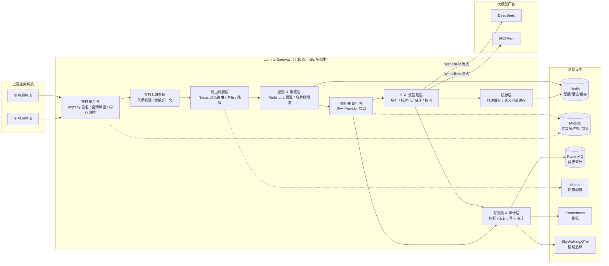
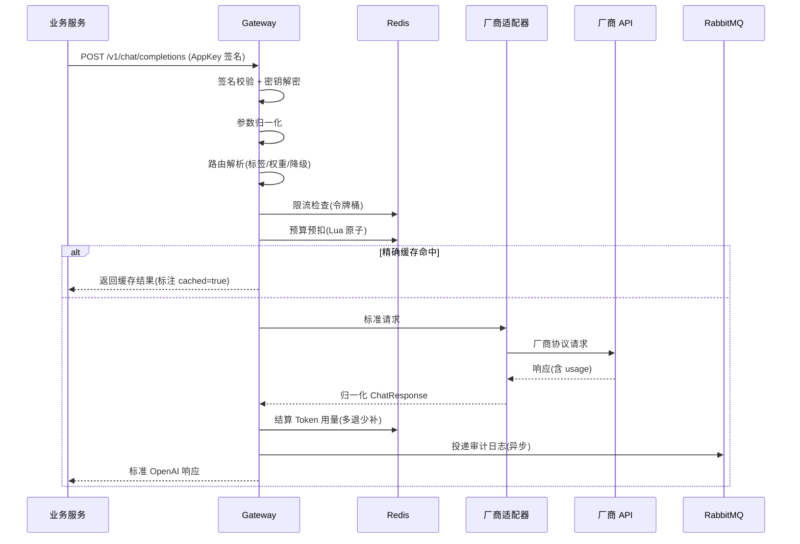
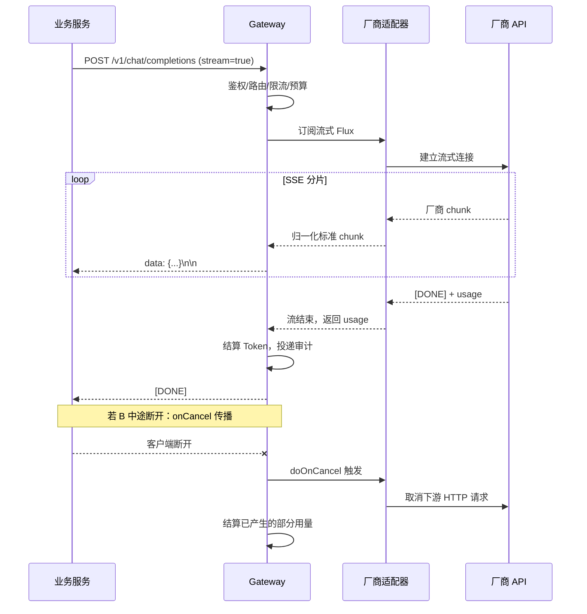
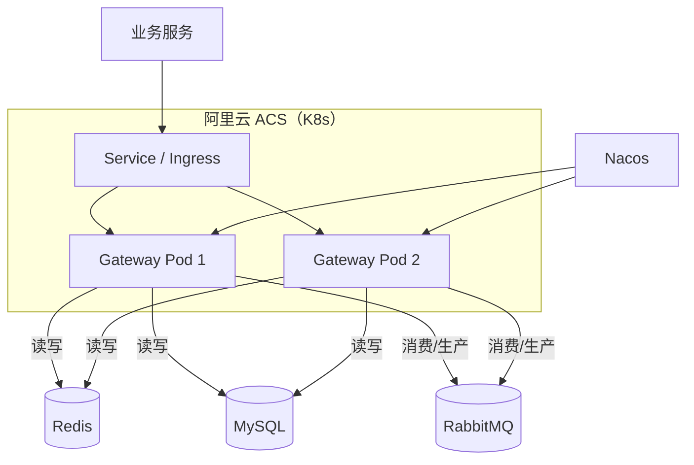

# Lumina Gateway 架构设计书

> 配套文档：`plan.md`（项目计划书）。本文档描述系统的总体架构、模块设计、数据模型、关键技术决策与难点实现方案，作为开发与评审的蓝图。

## 0. 文档信息

| 项 | 内容 |
|---|---|
| 项目 | Lumina Gateway — 异构大模型统一接入网关 |
| 技术栈 | Java 17 / Spring Boot 3.2 / Spring WebFlux / Reactor / Resilience4j / Nacos / Redis(RedisSearch) / RabbitMQ / MySQL / SkyWalking(或 OTel) / Prometheus / Docker / 阿里云 ACS |
| 定位 | 面向业务系统的 LLM 调用代理基础设施，提供标准化、可管控、可观测的接入服务 |
| 架构风格 | 无状态服务 + SPI 插件化 + 响应式流式管道 |

---

## 1. 设计目标与原则

| 原则 | 说明 | 落地手段 |
|---|---|---|
| 非阻塞优先 | SSE 长连接场景下，少量线程承载大量并发流 | WebFlux + Reactor 全链路异步 |
| 协议隔离 | 厂商差异收敛在适配器内，主流程零感知 | SPI Provider 接口 + 适配器实现 |
| 无状态 | 任意实例可处理任意请求，支持水平扩容 | 会话/配额/限流状态全部外置到 Redis |
| 可热更 | 路由、限流、熔断、开关无需重启即时生效 | Nacos 配置中心 + 监听回调 |
| 成本可控 | 熔断/降级/限流/缓存/断连取消多手段控费 | 见第 5、8 章 |
| 边界明确 | 只做网关，不做 RAG/本地推理/支付 | 遵循 plan.md「明确不做范围」 |

---

## 2. 总体架构

### 2.1 架构图



### 2.2 分层职责

| 层 | 职责 | 关键点 |
|---|---|---|
| 鉴权安全层 | AppKey HMAC 签名校验、厂商密钥解密、前置内容风控 | 两类密钥分离；签名防重放 |
| 参数标准化层 | 入参校验、字段归一化 | 统一为 OpenAI 结构，过滤未授权字段 |
| 路由调度层 | 标签/权重路由、主备故障转移、预算触发降级 | 全部规则 Nacos 可热更 |
| 配额 & 限流层 | 多维限流、Token 预算原子扣减、超额拦截 | Redis Lua 保证原子性 |
| 适配器 SPI 层 | 统一 Provider 接口，各厂商独立实现 | 隔离协议差异、归一化错误码与 usage |
| SSE 流管理层 | 流式分片解析、格式标准化、背压、断连取消 | Reactor 全链路取消传播 |
| 缓存层 | 精确哈希缓存、Embedding 语义缓存 | 仅确定性/非流式场景启用 |
| 可观测 & 审计层 | 指标埋点、链路透传、MQ 异步审计 | 同步不阻塞主链路 |

---

## 3. 核心请求链路

### 3.1 非流式调用时序



### 3.2 流式调用时序



---

## 4. 模块详细设计

### 4.1 统一协议模块（api + normalize）

对外严格兼容 OpenAI `/v1/chat/completions`，支持 `stream=true/false`。

核心 DTO（归一化后，内部统一结构）：

```java
public record ChatRequest(
    String model,
    List<ChatMessage> messages,       // role + content + (可选) name
    Double temperature,
    Integer maxTokens,
    boolean stream,
    Map<String, Object> extra          // 透传的厂商私有参数
) {}

public record ChatMessage(String role, String content, String name) {}

// 非流式响应
public record ChatResponse(
    String id,
    String model,
    List<Choice> choices,
    Usage usage,                       // 归一化后的 prompt/completion/total tokens
    long createdAt
) {}

// 流式分片
public record ChatChunk(String id, String model, List<ChoiceDelta> choices, Usage usage) {}

public record Usage(int promptTokens, int completionTokens, int totalTokens) {}
```

设计要点：

- 对外响应**必须**是可被 OpenAI 官方 SDK（python/node）直接解析的结构，字段命名、`[DONE]` 结束符、`data:` 前缀均保持一致。
- 入参校验：model 非空、messages 非空、temperature 范围 `[0,2]`、maxTokens 上限可配，非法请求直接 4xx 短路，不落到下游。

### 4.2 鉴权安全模块（auth）

**两类密钥分离管理**：

| 类型 | 用途 | 存储 | 校验方式 |
|---|---|---|---|
| AppKey / AppSecret | 上游业务调用网关 | MySQL（AppSecret 加密存储） | HMAC-SHA256 签名 + 时间戳/随机数防重放 |
| 厂商密钥 | 网关调用厂商 | MySQL（AES 加密，主密钥走 KMS/环境变量） | 仅解密注入，不返回给调用方 |

签名校验流程：

```
待签字符串 = HTTP_METHOD + "\n" + REQUEST_PATH + "\n" + TIMESTAMP + "\n" + NONCE + "\n" + BODY_SHA256
签名 = HMAC_SHA256(AppSecret, 待签字符串)
```

- 时间戳窗口（如 ±5min）拒绝过期请求；
- NONCE 写入 Redis（带 TTL）防重放；
- 校验失败统一返回 401，不区分「密钥不存在 / 签名错误」细节，避免信息泄露。

### 4.3 路由调度模块（routing）

```java
public interface RouteResolver {
    Mono<RouteTarget> resolve(RouteContext ctx);  // 返回目标模型 + 备选模型列表
}
```

路由维度与优先级（Nacos 动态配置）：

1. **标签路由**：按租户/应用绑定的标签组命中模型组；
2. **权重路由**：同组多模型按权重分流；
3. **主备故障转移**：主模型熔断/超时时切换备用模型；
4. **预算触发降级**：额度耗尽或逼近阈值时，从高价模型降级到廉价模型。

路由规则存储在 Nacos（JSON），变更时通过监听器刷新本地缓存，避免每次请求读远程。

### 4.4 配额与限流模块（quota）

- **限流**：Redis 令牌桶（Lua 实现），维度为 租户 / AppKey / 模型；
- **预算**：日预算 + 总预算，按租户 / App 维度；
- **额度预警**：用量达到阈值（如 80%/95%）时触发告警埋点。

预算扣减的原子性（Redis Lua）：

```lua
-- KEYS[1]=quota key, KEYS[2]=used key, ARGV[1]=delta, ARGV[2]=limit
local used = tonumber(redis.call('GET', KEYS[2]) or '0')
local limit = tonumber(ARGV[2])
if used + tonumber(ARGV[1]) > limit then
    return -1                          -- 超额，拒绝
end
redis.call('INCRBY', KEYS[2], ARGV[1])
redis.call('EXPIRE', KEYS[2], 86400)
return used + tonumber(ARGV[1])
```

结算策略：请求发起时**预扣**（按 maxTokens 估算），流/响应结束时按真实 usage **多退少补**，避免超额消费后无法追回。

### 4.5 适配器 SPI 模块（provider）

统一接口，隔离厂商差异：

```java
public interface ModelProvider {
    String provider();                       // 如 "deepseek" / "qwen"

    Mono<ChatResponse> chat(ChatRequest req, ProviderContext ctx);

    Flux<ChatChunk> chatStream(ChatRequest req, ProviderContext ctx);

    boolean supports(String model);          // 是否承载该模型
}
```

适配器内部职责：

- 协议映射（OpenAI 标准 ↔ 厂商自有协议）；
- chunk 解析与格式统一（含脏分片捕获丢弃）；
- **错误码归一化**（厂商错误 → 网关统一错误码：超时/限流/鉴权失败/内容风控/服务异常）；
- **usage 归一化**（见 8.3）。

扩展方式：新增厂商仅需新增一个 `ModelProvider` 实现并注册到 SPI（`META-INF/services` 或 Spring Bean 自动装配），主流程零改动。

### 4.6 SSE 流管理模块（sse）

核心：把厂商的响应式 `Flux<ChatChunk>` 通过 `text/event-stream` 转发，并保证取消与背压正确传播。

关键实现点：

```java
return provider.chatStream(req, ctx)
    .map(chunk -> format(chunk))                       // 归一化为 "data: {...}\n\n"
    .doOnCancel(() -> downstreamDisposable.dispose())  // 客户端断开 → 取消下游
    .concatWith(Mono.just("data: [DONE]\n\n"));
```

- **取消传播**：客户端断开触发 Reactor `onCancel`，逐级取消下游 `WebClient` 的 HTTP 请求，厂商停止生成，避免无效扣费；
- **背压**：写入客户端时，Netty 写压力会反向传播到厂商响应流；对解析失败或可丢弃的分片，用 `onBackpressureDrop` 或限长 `onBackpressureBuffer` 兜底，防止内存堆积；
- **闲置回收**：设置流超时，超过阈值未产出数据则主动取消并释放资源。

### 4.7 缓存模块（cache）

| 类型 | 命中条件 | 存储 | 说明 |
|---|---|---|---|
| 精确哈希缓存 | `temperature=0` 或显式确定性开关，且请求参数完全一致 | Redis String | 对「模型+完整入参」做哈希，命中直接返回 |
| 语义向量缓存 | 非流式、租户级开关开启、相似度 ≥ 阈值 | RedisSearch 向量索引 | Embedding 查询向量 → KNN 检索 → 返回历史缓存答案 |

精确缓存边界：仅当 `temperature=0`（或确定性输出）时才允许命中，否则不同调用可能得到不同结果，返回缓存会造成答案错乱。

语义缓存流程：

```
用户问题 → Embedding(可插拔模型) → 向量
   → RedisSearch FT.SEARCH (KNN, score >= 阈值)
       → 命中：返回缓存答案（标注 cached=true, similarity）
       → 未命中：调用模型 → 异步写入向量索引
```

- Embedding 模型独立配置、可插拔，支持低成本 API 或本地向量模型；
- 相似度阈值、TTL、租户开关均可热更；
- 仅非流式请求启用（流式无法安全复用缓存）。

### 4.8 审计与可观测模块（observability）

- **指标（Micrometer → Prometheus）**：QPS、P50/P95/P99 延迟、错误率、Token 消耗、缓存命中率、熔断触发次数、断连取消次数；
- **链路追踪**：WebFlux 场景优先 **Micrometer Tracing + OpenTelemetry**（Reactor 跨度连续性更好）；若用 SkyWalking，需验证其 Reactor 跨度传播，必要时以 OTel 为主、SkyWalking 为辅；
- **审计（异步，RabbitMQ）**：请求摘要（租户/应用/模型/参数哈希）、延迟、Token 用量、费用、状态、缓存命中标识，由独立消费者落库 MySQL，主链路不阻塞；
- **告警埋点**：错误率、预算预警、熔断打开等关键事件上报告警。

---

## 5. 数据模型设计

### 5.1 MySQL 表

```sql
-- 租户
CREATE TABLE tenant (
    id          BIGINT PRIMARY KEY,
    name        VARCHAR(128) NOT NULL,
    status      TINYINT NOT NULL DEFAULT 1,      -- 1启用 0禁用
    created_at  DATETIME NOT NULL
);

-- 应用（对外 AppKey）
CREATE TABLE app (
    id            BIGINT PRIMARY KEY,
    tenant_id     BIGINT NOT NULL,
    name          VARCHAR(128) NOT NULL,
    app_key       VARCHAR(64) NOT NULL UNIQUE,
    app_secret    VARBINARY(256) NOT NULL,        -- 加密存储
    status        TINYINT NOT NULL DEFAULT 1,
    created_at    DATETIME NOT NULL
);

-- 模型（计费单价、状态）
CREATE TABLE model (
    id              BIGINT PRIMARY KEY,
    provider        VARCHAR(32) NOT NULL,          -- deepseek / qwen
    model_name      VARCHAR(64) NOT NULL,
    input_price     DECIMAL(12,6) NOT NULL,        -- 每 1K token 价格
    output_price    DECIMAL(12,6) NOT NULL,
    status          TINYINT NOT NULL DEFAULT 1,
    UNIQUE KEY uk_provider_model (provider, model_name)
);

-- 厂商密钥（对内）
CREATE TABLE provider_secret (
    id           BIGINT PRIMARY KEY,
    provider     VARCHAR(32) NOT NULL,
    secret_enc   VARBINARY(512) NOT NULL,          -- AES 加密
    version      INT NOT NULL DEFAULT 1,
    status       TINYINT NOT NULL DEFAULT 1,
    created_at   DATETIME NOT NULL
);

-- 配额配置
CREATE TABLE quota_config (
    id           BIGINT PRIMARY KEY,
    tenant_id    BIGINT NOT NULL,
    app_id       BIGINT,
    daily_limit  BIGINT NOT NULL,                  -- 日预算（token）
    total_limit  BIGINT NOT NULL,                  -- 总预算
    warn_ratio   DECIMAL(4,2) NOT NULL DEFAULT 0.8
);

-- 审计日志（异步落库，按月可归档）
CREATE TABLE audit_log (
    id               BIGINT PRIMARY KEY,
    trace_id         VARCHAR(64),
    tenant_id        BIGINT,
    app_id           BIGINT,
    model            VARCHAR(64),
    prompt_hash      CHAR(64),
    prompt_tokens    INT,
    completion_tokens INT,
    latency_ms       INT,
    status           VARCHAR(16),                   -- ok / timeout / rejected / error
    cached           TINYINT DEFAULT 0,
    cost             DECIMAL(12,6),
    created_at       DATETIME NOT NULL
);
```

### 5.2 Redis 键设计

| 键 | 结构 | TTL | 说明 |
|---|---|---|---|
| `quota:used:{tenant}:{app}:{date}` | String（计数） | 1d | 日预算已用量 |
| `quota:total:{tenant}:{app}` | String（计数） | 长期 | 总预算已用量 |
| `rate:{tenant}:{app}:{model}` | 令牌桶 Hash | — | 限流状态 |
| `auth:nonce:{nonce}` | String | 5min | 签名防重放 |
| `cache:exact:{hash}` | String（JSON） | 可配 | 精确缓存 |
| `cache:sem:{tenant}` | RedisSearch 索引 | 可配 | 语义向量缓存 |
| `route:local` | 本地缓存 | — | Nacos 路由本地快照 |

---

## 6. 关键技术决策（ADR）

| # | 决策 | 备选 | 理由 |
|---|---|---|---|
| ADR-1 | WebFlux + Reactor 作为核心运行时 | 传统 Servlet 同步 | SSE 长连接高并发下线程模型不可持续，需异步非阻塞 |
| ADR-2 | SPI 适配器隔离厂商差异 | 单一 switch/if 分支 | 新增厂商零侵入，符合开闭原则 |
| ADR-3 | Redis Lua 实现预算原子扣减 | 本地锁 / DB 事务 | 多实例部署下需跨实例原子性，Lua 单次往返原子执行 |
| ADR-4 | RabbitMQ 承载异步审计 | 同步落库 / RocketMQ | 解耦主链路、削峰；RabbitMQ 部署运维成本低、生态成熟 |
| ADR-5 | RedisSearch 做向量检索 | 独立向量库（Milvus 等） | 复用已有 Redis 基础设施，降低运维面，量级满足缓存需求 |
| ADR-6 | Nacos 承载动态配置 | 本地配置 + 重启 | 路由/限流/熔断/开关需热更，Nacos 监听机制成熟 |
| ADR-7 | 追踪优先 Micrometer Tracing/OTel | SkyWalking 独占 | WebFlux/Reactor 跨度传播是硬需求，OTel 标准且生态广 |
| ADR-8 | 预算预扣 + 结算多退少补 | 事后统计扣减 | 事后统计无法阻止超额消费，预扣是唯一可控方案 |
| ADR-9 | 精确缓存仅 temperature=0 启用 | 无差别缓存 | 非确定性输出缓存会返回错误答案 |
| ADR-10 | 流式请求产生首字节后不重试 | 统一重试 | 重试会重复计费且输出错乱 |

---

## 7. 关键技术难点与实现方案

### 7.1 流式断连取消

- **问题**：客户端提前断开 SSE，若不下发取消，厂商继续生成，产生无效扣费。
- **方案**：Reactor 的取消沿 `Flux` 链传播。在转发流上挂 `doOnCancel`，触发下游 `WebClient` 订阅的 `Disposable.dispose()`；Netty 层随即关闭与厂商的连接。审计层结算「已产生」的部分用量。

### 7.2 背压处理

- **问题**：厂商产速 > 客户端消费速度，内存堆积导致 OOM。
- **方案**：
  - 写入端：`ServerHttpResponse.writeAndFlushWith()` 返回的 `Publisher` 天然带背压，Netty 写水位压力反向传播至上游 Flux；
  - 兜底：解析失败/可丢弃分片用 `onBackpressureDrop`，缓冲用限长 `onBackpressureBuffer`（如 256 条）+ 溢出丢弃策略；
  - 设置分片缓冲上限与流超时回收闲置连接。

### 7.3 Token 口径归一化

- **问题**：各厂商 usage 字段命名/口径不一致，流式请求 usage 只出现在末尾。
- **方案**：适配器层统一映射到 `Usage(prompt, completion, total)`；流式请求以流结束 usage 为准；usage 缺失时按模型计价估算，并在审计记录中标记 `estimated=true`。

### 7.4 分布式额度原子扣减

见 4.4 的 Lua 脚本，单次 `EVAL` 完成「检查 + 扣减」，杜绝竞态。

### 7.5 语义缓存误召回

- 相似度阈值可配；
- 租户维度单独开关，高可靠场景直接关闭；
- 命中结果标注 `similarity` 与 `cached=true`，业务侧可感知并自行决策。

### 7.6 熔断 / 重试 / 降级

- Resilience4j（`resilience4j-reactor` 模块）与 Reactor 集成；
- 熔断：按「模型」维度，失败率/慢调用率触发打开；
- 重试：仅连接异常、5xx 服务异常；严格排除 4xx、内容风控、限流、鉴权失败；
- 降级：主模型熔断 → 备选模型；预算逼近阈值 → 高价转低价模型；
- 所有阈值、开关经 Nacos 热更。

---

## 8. 安全设计

| 威胁 | 对策 |
|---|---|
| AppKey 泄露/伪造 | HMAC 签名 + 时间戳窗口 + NONCE 防重放 |
| 厂商密钥泄露 | AES 加密存储，主密钥走 KMS/环境变量不落库，支持轮换重加密 |
| Prompt 注入/敏感内容 | 前置内容风控过滤（阶段 4） |
| 越权访问 | 租户/应用维度隔离，密钥权限最小化 |
| 传输安全 | 全程 HTTPS/TLS（对外与对厂商均加密） |
| 审计篡改 | 审计日志只写不改，记录 trace_id 关联追踪 |

---

## 9. 部署架构



- **无状态**：Pod 不持有本地会话，可任意扩缩容；
- **健康检查**：`/actuator/health`（liveness）与 `/actuator/health/readiness`（就绪探针，依赖 Redis/MySQL 可用）；
- **优雅停机**：接收 SIGTERM 后停止接收新请求，等待在途流完成或超时，再退出；
- **配置**：Nacos 作为外部配置中心，路由/限流/熔断/开关热更。

---

## 10. 可观测性

| 信号 | 工具 | 关键指标 |
|---|---|---|
| Metrics | Micrometer + Prometheus | 请求量、P50/P95/P99、错误率、Token、缓存命中率、熔断次数、断连取消数 |
| Tracing | OTel（优先）/ SkyWalking | 单请求跨网关与厂商的完整链路 |
| Logging | 结构化日志 + trace_id | 请求/响应摘要、异常堆栈 |
| Auditing | RabbitMQ → MySQL | 计费级调用明细、额度变化 |
| Alerting | 告警规则 | 错误率、预算预警、熔断打开、限流激增 |

---

## 11. 风险与预案

| 风险 | 预案 |
|---|---|
| 厂商 SSE 格式差异大 | 适配器隔离解析，脏分片捕获丢弃，单测覆盖各家样例 |
| 预算并发竞态 | Redis Lua 原子扣减 |
| 语义缓存误召回 | 阈值/开关可配，命中标注 similarity |
| 背压失控 OOM | Reactor 背压 + 限长缓冲 + 流超时回收 |
| 重试放大费用 | 可重试异常白名单 + 流式不重试 |
| 追踪跨度断裂 | 以 OTel 为主，验证 Reactor 跨度传播 |
| 主密钥泄露 | KMS 托管 + 轮换重加密 |

---

## 12. 模块包结构建议

```
com.lumina.gateway
├── api                 # OpenAI 兼容 controller + DTO
├── auth                # 签名校验、密钥解密
├── normalize           # 参数校验、归一化
├── routing             # 路由解析、Nacos 监听
├── quota               # 限流、预算扣减（Lua）
├── provider            # SPI 接口 + 各厂商适配器
│   ├── spi
│   ├── deepseek
│   └── qwen
├── sse                 # 流式转发、取消、背压
├── cache               # 精确缓存、语义缓存
├── observability       # 指标、追踪、审计
├── config              # Nacos 动态配置绑定
└── infra               # Redis/MySQL/MQ 客户端封装
```
